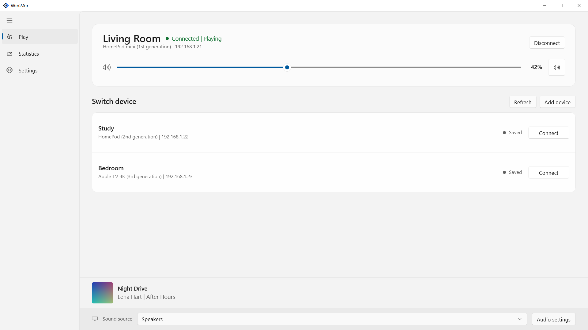
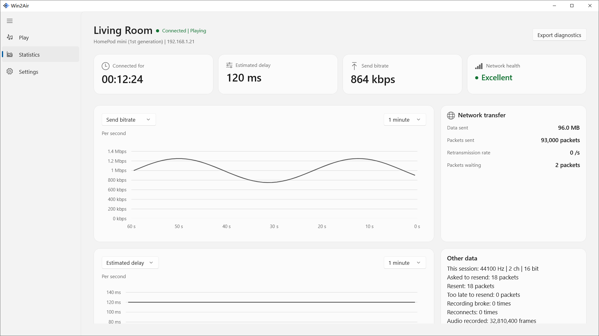
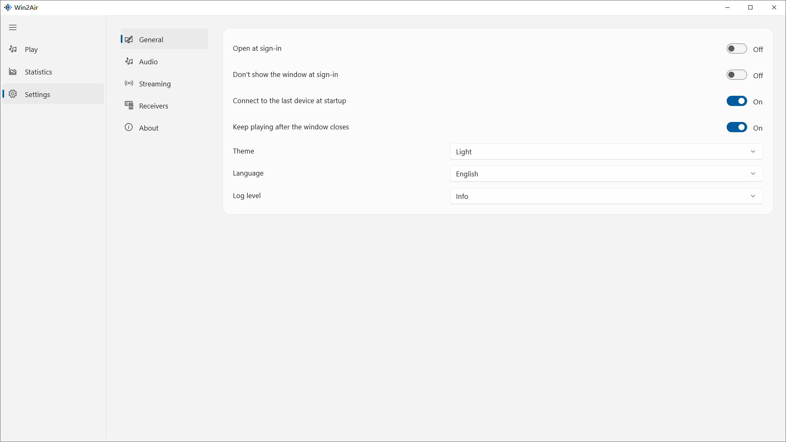

<p align="center">
  English ·
  <a href="README.zh-Hans.md">简体中文</a>
</p>

<h1 align="center">Win2Air</h1>

<p align="center">
  Send Windows system audio to HomePod, Mac, and other AirPlay devices.
</p>

<p align="center">
  
  
</p>

<p align="center">
  
</p>

Win2Air is an AirPlay audio sender for Windows. It sends the audio playing on the PC to a HomePod, a Mac with AirPlay Receiver turned on, and other AirPlay audio devices.

Select a receiver and connect to start. You can change the volume, mute, or disconnect in Win2Air.

## Install

Install Win2Air from the Microsoft Store: <https://apps.microsoft.com/detail/9NW4QNG96D6T>.

You can also build it from source. After the build, run `win2air-app/out/bin/Debug/Win2Air.exe`. The steps are in [Build](#build).

## Features

- Sends Windows system audio to an AirPlay receiver, one device at a time
- Finds receivers on the local network, or you enter an address
- Connect, disconnect, volume, and mute
- Captures the current system output by default, or another output you choose
- Can turn off local playback on the PC while sending, and restores it after disconnect
- Bitrate, delay, and network status on the statistics page
- The system tray shows the current connection, and can change the volume or disconnect
- Simplified Chinese and English, and three theme modes: match the system, light, and dark

## Preview

### Statistics

<p align="center">
  
</p>

### Settings

<p align="center">
  
</p>

## Usage

1. Keep the Windows PC and the AirPlay receiver on the same local network.
2. Open Win2Air, select a receiver on Play, and click Connect.
3. If the device is not in the list, click Add device and enter its address.
4. If the receiver asks for a pairing code, enter it in the dialog.
5. After it connects, change the receiver volume or mute it. Click Disconnect to stop.

After you close the main window, the system tray can still manage the current connection. Audio capture, streaming, and receiver management are on the Settings page.

## What it needs

| Item | Required | Used for |
| --- | --- | --- |
| Audio output | Yes | Capture system audio from the selected output |
| Local network | Yes | Find the receiver and send the audio |
| Pairing code | Only when the receiver asks | Complete the connection |

## Requirements

- Windows 10 22H2 (build 19045) or Windows 11
- x64
- An AirPlay audio receiver on the same network as the PC

## Build

From the repository root, run these in order:

```powershell
cmake -P win2air-app/scripts/build-sender.cmake
cmake -P win2air-app/scripts/build-app.cmake
```

The build needs Visual Studio 2026 with the Desktop development with C++ workload, Windows SDK 26100, and the .NET 10 SDK. The sender DLL is built with the MinGW toolchain included in the project.

The Debug executable is at `win2air-app/out/bin/Debug/Win2Air.exe`.

## FAQ

### Can it send video?

No. Win2Air sends system audio only, and does not send video.

### Can it connect to more than one receiver at a time?

Not yet. One receiver at a time.

### Which receivers work?

AirPlay audio receivers, such as a HomePod, a Mac with AirPlay Receiver turned on, and other compatible devices. The PC and the receiver need to be on the same network.

### Does it run on Windows ARM64?

Not in this build. This build targets x64.

## License

Win2Air is licensed under [GPL-3.0-or-later](LICENSE). The sender includes GPL code from OwnTone; the third-party license texts are in [`airplay2-sender-core/LICENSES`](airplay2-sender-core/LICENSES).
