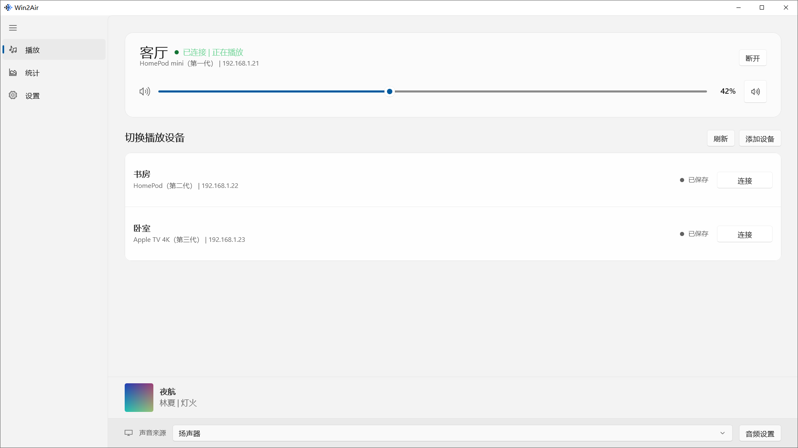
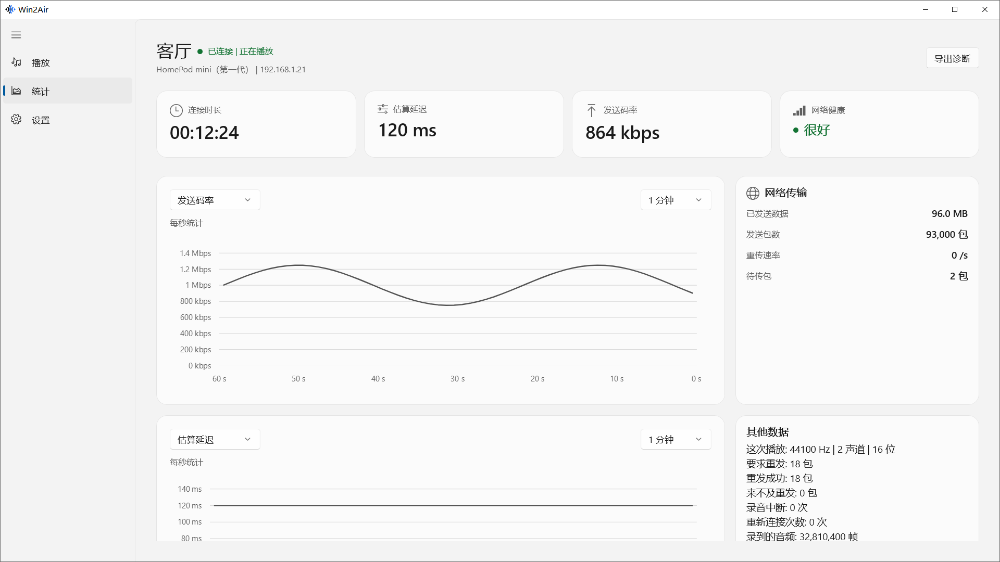
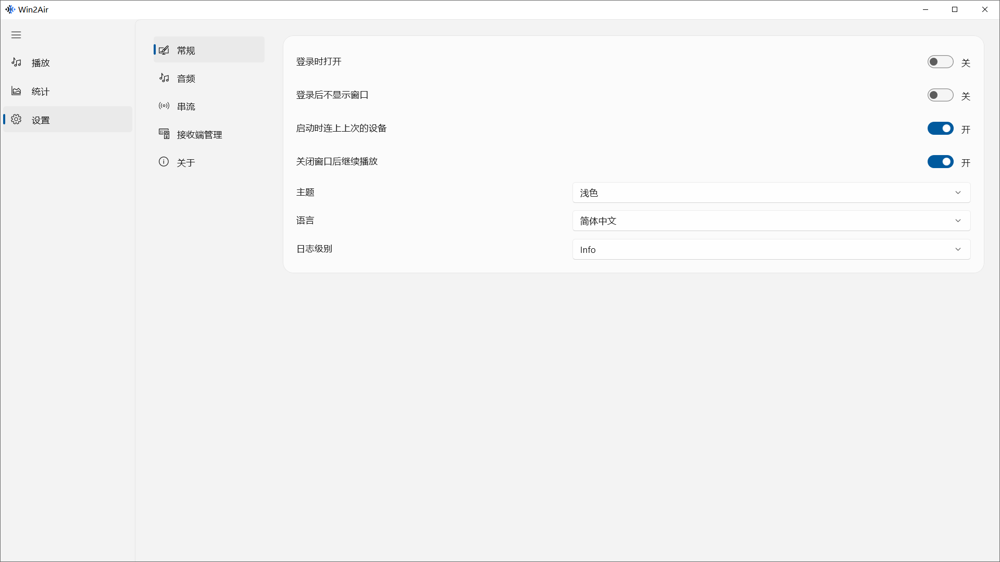

 <p align="center">
  <a href="README.md">English</a> · 简体中文
</p>

<h1 align="center">Win2Air</h1>

<p align="center">
  将 Windows 系统声音投送到 HomePod、Mac 等 AirPlay 设备。
</p>

<p align="center">
  
  
</p>

<p align="center">
  
</p>

Win2Air 是一款适用于 Windows 的 AirPlay 音频投送工具，可以将电脑正在播放的声音传输到 HomePod、已开启 AirPlay 接收功能的 Mac，以及其他兼容 AirPlay 的音频设备。

选择接收设备并连接，即可开始投送。你可以直接在 Win2Air 中调节音量、静音或断开连接。

## 安装

从 Microsoft Store 安装 Win2Air：<https://apps.microsoft.com/detail/9NW4QNG96D6T>。

也可以通过源码构建。构建完成后，运行 `win2air-app/out/bin/Debug/Win2Air.exe`。具体步骤见下方的[构建说明](#构建)。

## 功能

- 将 Windows 系统声音投送到 AirPlay 音频接收设备，一次支持连接一台设备
- 自动发现局域网接收端，或手动填写地址
- 支持连接、断开、音量调节和静音
- 默认采集系统当前的音频输出，也可指定其他输出设备
- 投送期间可关闭电脑本地播放，断开连接后自动恢复
- 在统计页面查看码率、延迟和网络状态
- 通过系统托盘查看当前连接、调节音量或断开设备
- 支持简体中文和英文，以及跟随系统、浅色和深色三种主题模式

## 界面预览

### 统计

<p align="center">
  
</p>

### 设置

<p align="center">
  
</p>

## 使用方法

1. 确保 Windows 电脑与 AirPlay 接收设备处于同一局域网。
2. 打开 Win2Air，在「播放」页面选择接收设备，点击「连接」。
3. 如果设备没有出现在列表中，点击「添加设备」，手动填写设备地址。
4. 如果接收设备要求验证码，请在弹出的窗口中输入。
5. 连接成功后，可以调节接收端音量或静音；点击「断开」即可停止投送。

关闭主窗口后，仍可通过系统托盘管理当前连接。音频采集、串流和接收设备管理等选项可在设置页面调整。

## 使用条件

| 项目 | 是否必需 | 用途 |
| --- | --- | --- |
| 音频输出设备 | 是 | 采集选定输出设备的系统声音 |
| 局域网连接 | 是 | 发现接收设备并传输音频 |
| 验证码 | 仅在接收设备要求时 | 完成连接验证 |

## 系统要求

- Windows 10 22H2（内部版本 19045）或 Windows 11
- x64 架构
- 与电脑位于同一网络的 AirPlay 音频接收设备

## 构建

在仓库根目录依次运行：

```powershell
cmake -P win2air-app/scripts/restore-packages.cmake
cmake -P win2air-app/scripts/build-sender.cmake
cmake -P win2air-app/scripts/build-app.cmake
```

构建环境需要 Visual Studio 2026（安装「使用 C++ 的桌面开发」工作负载）、Windows SDK 26100 和 .NET 10 SDK。发送器 DLL 使用项目提供的 MinGW 工具链构建。

Debug 版本的可执行文件位于：`win2air-app/out/bin/Debug/Win2Air.exe`。

## 常见问题

### 支持视频投送吗？

不支持。Win2Air 仅投送系统音频，不传输视频画面。

### 可以同时连接多个接收设备吗？

暂不支持。每次只能连接一台接收设备。

### 支持哪些接收设备？

支持 AirPlay 音频接收的设备，例如 HomePod、已开启 AirPlay 接收功能的 Mac，以及其他兼容设备。电脑与接收设备需要处于同一网络。

### 支持 Windows ARM64 吗？

当前不支持。现有构建面向 x64 架构。

## 许可证

发送器包含 OwnTone 的 GPL 代码。相关许可文本见 [`airplay2-sender-core/LICENSES`](airplay2-sender-core/LICENSES)。
